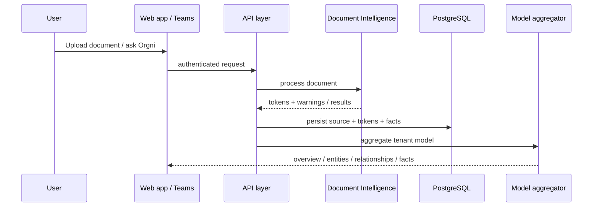
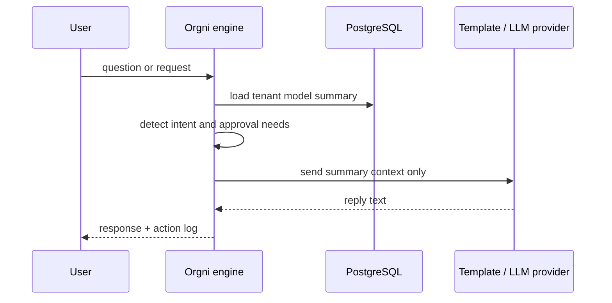

# Orgni Repository and Database Assessment

## Scope

This document is the Phase 1 baseline for Orgni. It reviews the repository as it exists today, identifies what is implemented versus what is planned, and explains the current information flow before any major architectural changes are made.

This assessment is based on the existing repository state, the current schema, the request engine, the API routes, and the technology stack document. It is a repository-level assessment, not a live production audit.

---

## Executive summary

Orgni already contains a credible first-pass foundation for a document-driven knowledge platform:

- PostgreSQL-backed persistence for uploaded sources, extracted tokens, fact payloads, and review actions already exists.
- Tenant-scoped queries and read-only model aggregation are implemented in the API layer.
- The product and Teams integration layers are present and route through a shared engine model.
- Authentication and multi-tenant account flows are implemented for users, tenants, and ownership boundaries.

However, the repository does not yet implement the complete agentic-memory architecture described in the roadmap. In particular:

- the assistant does not currently retrieve and reason over the actual document contents or fact payloads from storage;
- the request path forwards only summary metadata rather than evidence-bearing records;
- the planned Phase 4 memory architecture (working, episodic, semantic, compressed/retrieval memory) is still design-level work, not a completed implementation;
- there is no evidence of a production-ready semantic retrieval index, graph store, or Redis-backed memory subsystem in the current code.

The net conclusion is: Orgni is not a blank slate, but it is also not yet a complete agentic organizational-memory platform. The right next move is to design around the actual repository, not to replace what already works with a speculative architecture.

---

## 1. Repository structure and system boundaries

The repository already reflects a modular engineering layout, even if not all modules are fully implemented.

### 1.1 Current repository composition

Key areas in the repo include:

- [artifacts/api-server](../artifacts/api-server) — primary API, request engine, document processing, product/tenant logic, and Teams integration.
- [lib/db](../lib/db) — PostgreSQL schema and repository layer.
- [lib/api-spec](../lib/api-spec) and [lib/api-client-react](../lib/api-client-react) — API contract definitions and typed client generation.
- [intelligence/document-intelligence](../intelligence/document-intelligence) — the Python document intelligence runtime.
- [orgni](../orgni) — web application frontend.
- [scripts](../scripts) — tooling and project support.
- [reports](../reports) — architecture and audit artifacts.

This is a monorepo structure with a clear separation between:

1. product and API control plane;
2. database and schema persistence;
3. document-intelligence pipeline;
4. frontend consumption; and
5. integration surfaces such as Microsoft Teams.

### 1.2 Functional boundaries already present

The codebase is already organized around the major architectural domains discussed in the design brief:

- User interface: web frontend and Teams bot flow.
- Application/API layer: Express routes, auth, model aggregation endpoints, tenant-aware product state.
- Intelligence layer: document processing pipeline plus ontology/fact generation.
- Data layer: PostgreSQL schema and persistence.
- Integration layer: Microsoft Teams connectivity and identity resolution.
- Governance/security: tenant-scoped requests, session enforcement, audit-oriented patterns, approval workflows.

The main question is not whether those layers exist; it is whether they are connected as a complete, evidence-driven AI memory system.

---

## 2. What is already implemented

### 2.1 Database persistence for document knowledge

The central persistence model is defined in [lib/db/src/schema/documents.ts](../lib/db/src/schema/documents.ts).

The principal tables are:

- `sources` — one row per uploaded document, with tenant, checksum, MIME, state, document type, warnings/errors, and upload metadata.
- `tokens` — extracted organizational tokens, stored as JSONB values per source.
- `facts` — a source-level ontology result payload, also JSONB-based.
- `reviews` — reviewer corrections and approvals for extracted data.

This gives Orgni a basic evidence store:

- source documents are anchored to a tenant;
- token extraction results are persisted;
- fact payloads are persisted per source;
- review actions remain auditable and source-scoped.

The repository layer in [lib/db/src/repository.ts](../lib/db/src/repository.ts) enforces tenant-scoped reads and writes and centralizes persistence around `persistDocument`, `loadTenantModel`, `listTenantTokens`, and the corresponding source/review lookups.

### 2.2 Document ingestion and ontology pipeline

The document routes in [artifacts/api-server/src/routes/documents.ts](../artifacts/api-server/src/routes/documents.ts) already show a working ingestion pattern:

1. upload a file;
2. compute content checksum;
3. detect idempotent replay;
4. process with the document-intelligence pipeline;
5. map tokens to ontology/facts when configured;
6. perform duplicate checks;
7. persist source, tokens, facts, and review metadata in PostgreSQL;
8. return the processed payload to the caller.

This is a real operational pipeline and not just a schema stub.

### 2.3 Model aggregation and read-only views

The API routes in [artifacts/api-server/src/routes/model.ts](../artifacts/api-server/src/routes/model.ts) load a tenant model and expose read-only views for:

- overview
- entities
- relationships
- facts
- exceptions
- activity

The aggregation logic in [artifacts/api-server/src/lib/model.ts](../artifacts/api-server/src/lib/model.ts) derives those views from stored fact payloads without mutating the source data. This is the primary evidence-layer presentation model in the repo today.

### 2.4 Product engine and orchestration shell

The request engine in [artifacts/api-server/src/product/engine.ts](../artifacts/api-server/src/product/engine.ts) defines an intent-driven flow for Orgni:

- identify the tenant;
- detect the user intent;
- evaluate capability and approval gates;
- gather limited context;
- compose a deterministic or provider-backed response.

This is the closest thing to an operational “agent” in the current repo. It is not yet a full memory-based agent runtime, but it is a genuine execution shell.

### 2.5 Teams integration

Microsoft Teams is not an afterthought. The repository has explicit Teams bot code and identity flow documentation, especially in [artifacts/api-server/src/teams/README.md](../artifacts/api-server/src/teams/README.md) and the routes under [artifacts/api-server/src/routes/teams.ts](../artifacts/api-server/src/routes/teams.ts).

This matters because Teams is a real user surface for Orgni and should be treated as part of the overall system design, not as a disconnected channel. The current implementation resolves tenant and user identity before invoking the engine, and the system expects a tenant-scoped product state to drive capabilities.

### 2.6 Authentication and tenant boundaries

The authentication design is documented in [README.md](../README.md). It describes:

- account registration;
- email verification;
- password resets;
- sign-in and session policies;
- tenant creation for each organisation;
- a multi-tenant account/member model.

This is an important part of the architectural baseline: Orgni already treats tenant and account isolation as a first-class concern.

---

## 3. Database assessment

### 3.1 Current database model

The repository contains a grounded but still early PostgreSQL schema centered on document evidence and operational state.

#### Core persisted domain objects

| Domain | Existing implementation | Notes |
|---|---|---|
| Organizations / tenants | `organisations` and tenant-scoped records in auth flow | present in authentication and product identity model |
| Users and access | accounts, members, roles, sessions | documented in auth design |
| Documents | `sources` | persists uploaded files and lineage |
| Evidence / tokens | `tokens` | extracted token payloads |
| Facts | `facts` | ontology result payloads |
| Reviews | `reviews` | review actions and exceptions |
| Audit / governance | product audit pattern and auth audit hooks | present, but not a full unified audit model |

The important thing is that the repo does not yet show an extensive operational database with dozens of unrelated service-specific silos. Instead, the schema is intentionally narrow and evidence-centric.

### 3.2 Tenant isolation patterns

The schema and repository layer consistently apply tenant filters:

- `sources` are tenant-scoped;
- `tokens` and `facts` carry a `tenant_id`;
- repository reads and writes are passed an explicit tenant ID;
- model views are built from the tenant’s records only.

This is strong evidence of a deliberate design direction. The repo is not “one giant flat database.” It is designed around the requirement that an Orgni tenant must not be able to read another tenant’s data.

### 3.3 What the schema is not yet doing

The current schema does not yet show the storage layer required for the full planned agentic AI architecture:

- no vector embeddings or pgvector integration;
- no semantic retrieval tables or similarity indexes;
- no working-memory or episodic-memory tables;
- no event store or outbox model for durable runs at scale;
- no explicit graph store schema in PostgreSQL or Neo4j integration code;
- no explicit memory-compression or summary tables;
- no approval/workflow tables beyond product capability state and policy gating.

This is not a failure of the current design; it is simply a sign that Phase 1 is real and later phases are still planned.

---

## 4. How information currently moves through Orgni

The repository paints a clear operational flow for the implemented system.

### 4.1 Document intake flow

This is a functional end-to-end flow for evidence collection and tenant-scoped presentation. It is not yet full knowledge retrieval.

### 4.2 Request/answer flow

The actual request engine path is the critical missing link:

The evidence from [artifacts/api-server/src/product/engine.ts](../artifacts/api-server/src/product/engine.ts) is clear: the engine gathers metadata such as document counts and the newest filename, then forwards those summary strings. It does not currently pass the actual facts, tokens, or source excerpts into the provider.

That is the crucial gap between “document knowledge exists” and “the AI is retrieving knowledge to answer questions.”

---

## 5. What is missing to support the intended agentic AI architecture

The attachment’s proposed architecture is sound, but the repo shows that the following capabilities are still missing or only partially implemented.

### 5.1 Content-level retrieval is missing

The current storage layer has evidence, but the request path does not currently retrieve and ground answers in those facts. This is the biggest architectural gap.

Required next step:

- retrieve relevant source records, fact payloads, entities, and evidence snippets for the current query;
- filter by tenant and user permissions;
- return a bounded, ranked evidence set to the model;
- preserve provenance in every answer and citation.

### 5.2 No complete memory architecture is implemented

The technology stack document describes a future memory system including working memory, episodic memory, semantic memory, and compressed summaries. The current repository does not show that implementation. There is no evidence of:

- Redis-backed working memory;
- vector retrieval via pgvector;
- graph data projection to Neo4j;
- temporal memory checkpoints;
- episodic event records for query context and agent execution.

### 5.3 Approval and governance are partly present but not yet platform-wide

The engine has capability gates and approval categories, which is good. However, the broader governance architecture still needs explicit design for:

- approval workflows for sensitive actions;
- organization-specific policy evaluation;
- evidence chain-of-custody;
- permission-aware retrieval and cross-tenant controls;
- audit coverage beyond basic actions.

### 5.4 Semantic search and retrieval quality are not yet designed as a first-class component

There is a model view layer and a fact store, but no retrieval index, ranking layer, or contextual grounding step between storing facts and answering questions.

The broken point is not “database design” alone. It is the absence of a retrieval pipeline that converts raw organizational evidence into answerable context for the model.

---

## 6. Assessment of the current implementation status

### Implemented

- tenant-aware persistence for documents and extracted knowledge
- document ingestion and processing pipeline
- model aggregation views for facts, entities, and relationships
- Teams script and bot identity resolution
- auth and tenant onboarding flow
- product capability/approval framework

### Partially implemented

- cross-document reasoning
- retrieval from persisted knowledge into agent context
- memory architecture
- workflow approval lifecycle
- semantic grounding of answer generation

### Still planned

- full memory stack
- mgmt of working, episodic, semantic memory
- pgvector or graph retrieval layer
- retrieval-aware AI answer generation
- broader governance, policy, and audit architecture

---

## 7. Recommended design direction

The correct approach is not to scrap the current system. It is to build on the foundations already present.

### 7.1 Keep PostgreSQL as the source of truth

The repo already has a legitimate canonical relational data layer. Any future architecture should retain PostgreSQL as the primary system of record for:

- sources
- facts
- tokens
- review actions
- tenant and membership models
- audit/event records

Additional stores like Neo4j, Redis, or vector indexes should be treated as projections or auxiliary layers, not separate primary systems.

### 7.2 Treat retrieval as a first-class component

The next architecture milestone should be an explicit retrieval pipeline:

1. identify the tenant and user;
2. resolve user permissions;
3. retrieve candidate documents and facts;
4. rank by relevance and recency;
5. pass evidence to the model;
6. record the evidence used in the action log.

This is the essential missing bridge between the current data model and the intended AI behavior.

### 7.3 Design memory in stages

Use staged milestones instead of designing a full future platform in one step.

- Stage A: evidence grounding and retrieval from stored facts
- Stage B: basic working memory and a tenant-scoped context window
- Stage C: episodic event records and agent traceability
- Stage D: semantic memory and vector search
- Stage E: policy-governed action execution with approvals

### 7.4 Keep Teams as part of the architecture model

Because Teams is already part of the implementation, it should remain part of the platform architecture, not an optional wrapper. The architecture diagram should show:

- frontend / web app
- Teams bot and identity resolution
- API engine
- document and knowledge stores
- retrieval and memory services
- governance and approval layer

---

## 8. Conclusion

Orgni is already more than a concept. It has working document ingestion, a tenant-aware fact store, a reviewable model layer, an application engine, and a Teams integration path. That is a solid engineering foundation.

But it is not yet a complete AI-native organizational memory system. The important design gap is not a lack of ambition; it is the missing bridge between persisted facts and the actual AI reasoning path.

The correct next step is therefore not to redesign everything from scratch. The correct next step is:

1. validate the current repository and database baseline;
2. design the retrieval and memory architecture against what exists;
3. build the missing evidence-grounding pipeline before broadening to additional infrastructure.

This keeps Orgni grounded in its actual implementation while still moving toward the intended agentic architecture.
